# ShopEasy

A full-stack online shop built with **Angular**, three **Spring Boot** services, **Hibernate/JPA** and **MySQL**. It covers the parts of a real shop that are hard to get right: sign-up with email verification, role-based access, orders that belong to their owner, stock that can't be oversold, and email notifications.

<p align="center">
  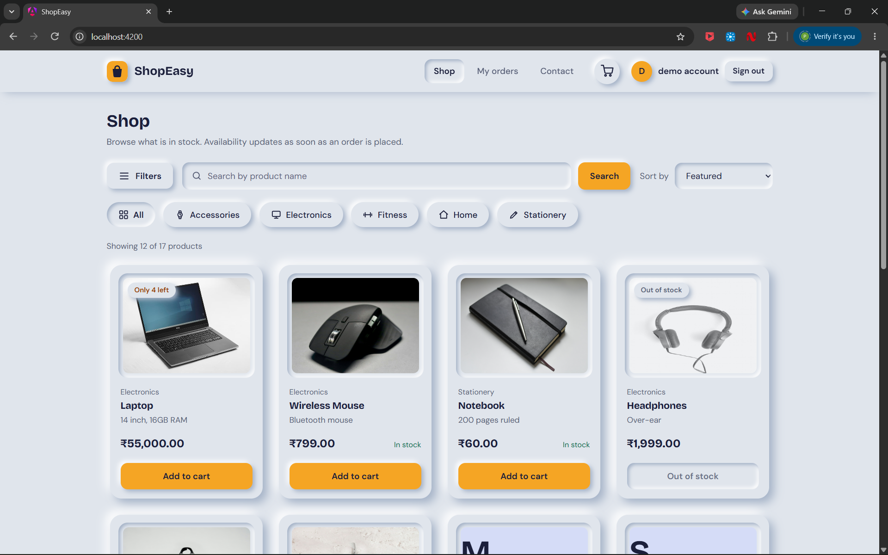
</p>

## Contents

- [Highlights](#highlights)
- [Screenshots](#screenshots)
- [Architecture](#architecture)
- [How an order is placed](#how-an-order-is-placed)
- [Security](#security)
- [Tech stack](#tech-stack)
- [API overview](#api-overview)
- [Database](#database)
- [Getting started](#getting-started)
- [How it was tested](#how-it-was-tested)
- [Project structure](#project-structure)
- [Known limits and roadmap](#known-limits-and-roadmap)
- [Credits](#credits)

## Highlights

- **Three services, three databases.** `auth-service` (accounts), `product-service` (catalogue and stock) and `order-service` (orders), each with its own MySQL database and its own limited database account.
- **No overselling.** Stock is reduced with one atomic conditional `UPDATE`. Ten simultaneous orders for the last item produce exactly one order.
- **Real authentication.** Email verification codes at sign-up, BCrypt passwords, JWT access tokens, forgot-password by emailed code, and a second email-code step for admin sign-in.
- **Access control that is enforced on the server.** Public catalogue reads, admin-only catalogue changes, and orders that only their owner (or an admin) can read.
- **Email.** Verification codes, password reset codes, a "new sign-in" alert, and order confirmations sent in the background.
- **Server-side filtering and pagination.** Search, category, price range, in-stock only and four sort orders, all in one query.
- **A designed interface.** A soft, neumorphic Angular UI with a slide-in filter drawer, photo product cards, a product page, a cart and order history.

## Screenshots

### Shopping

| | |
|---|---|
| <br>**Shop.** Search, category chips and product cards with live stock badges. | 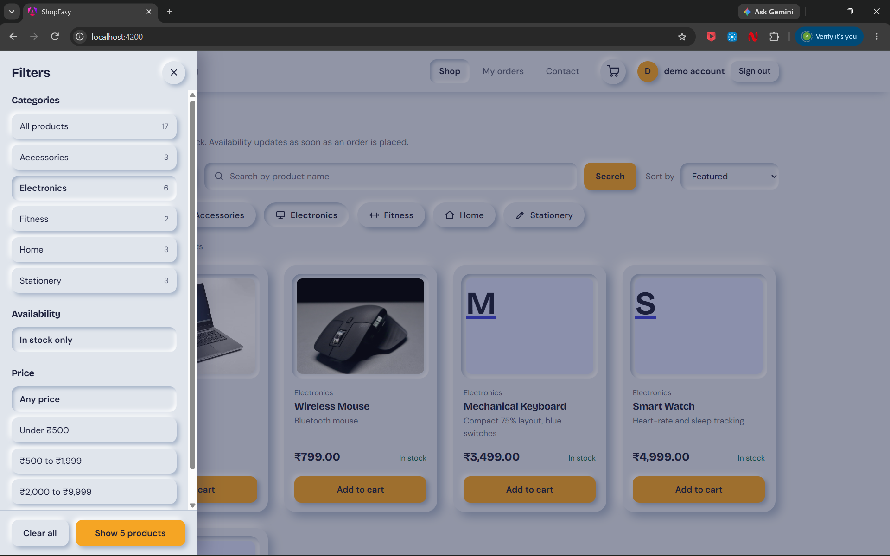<br>**Filter drawer.** Category, availability and price filters, opened from the three-line button. |
| 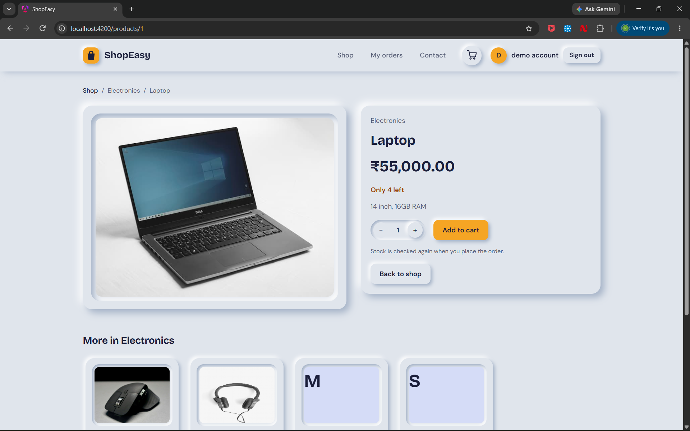<br>**Product page.** Photo, stock, quantity stepper and related products. | 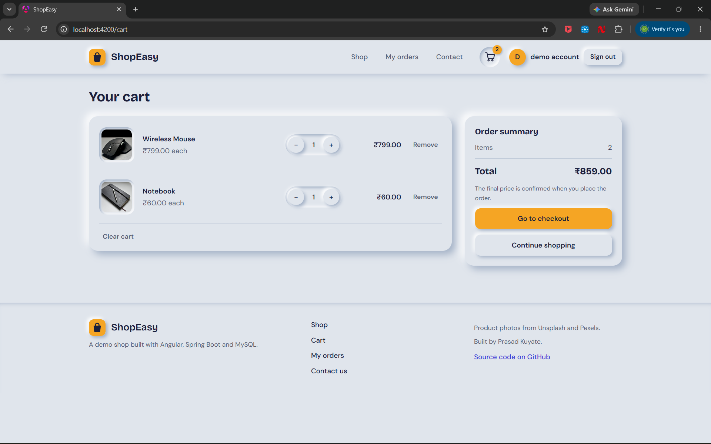<br>**Cart.** Quantities are capped at the stock that is available. |
| 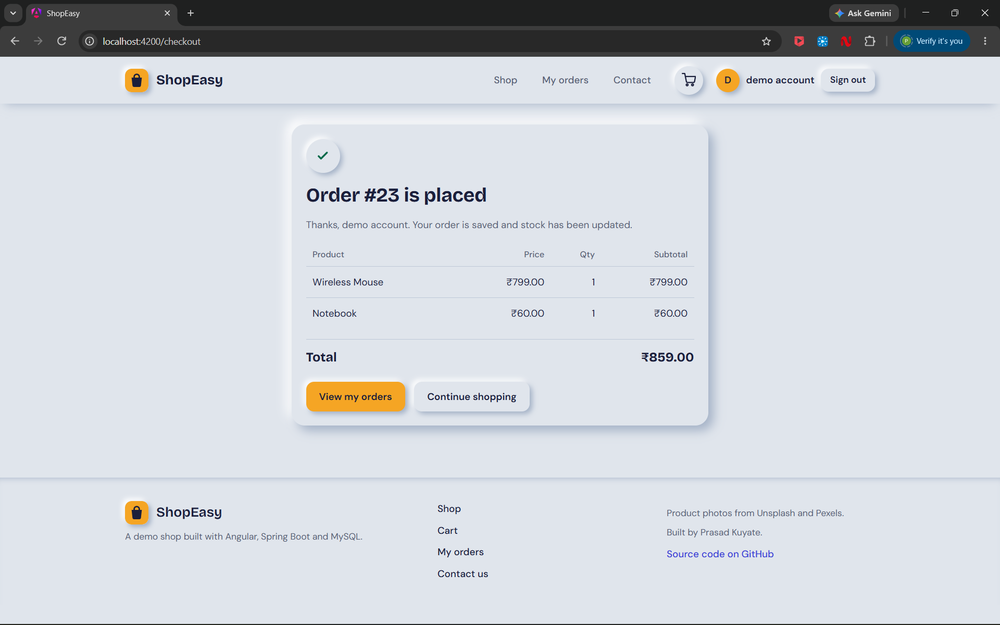<br>**Order placed.** Confirmation with the items and the total. | 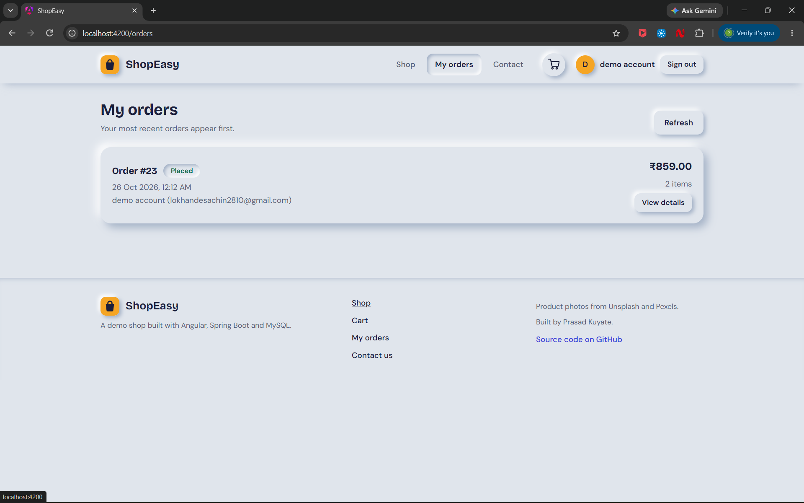<br>**My orders.** Each customer sees only their own orders. |

### Accounts and admin

| | |
|---|---|
| 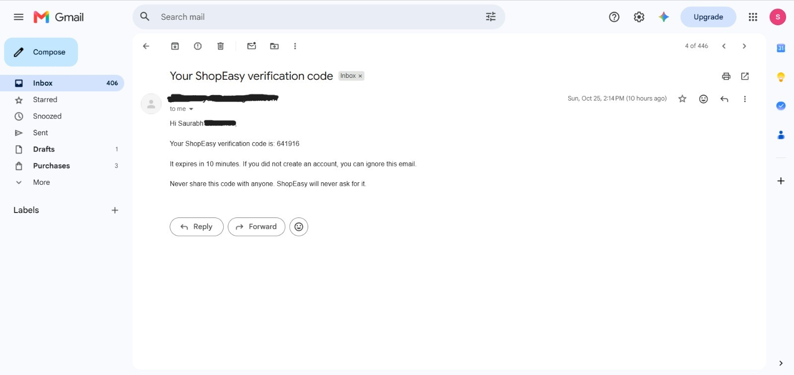<br>**Email verification.** A new account must enter a 6-digit code before it can sign in. | 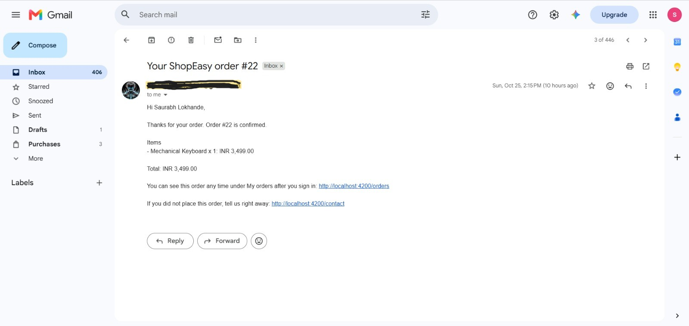<br>**The code email.** Sent through Gmail SMTP. |
| 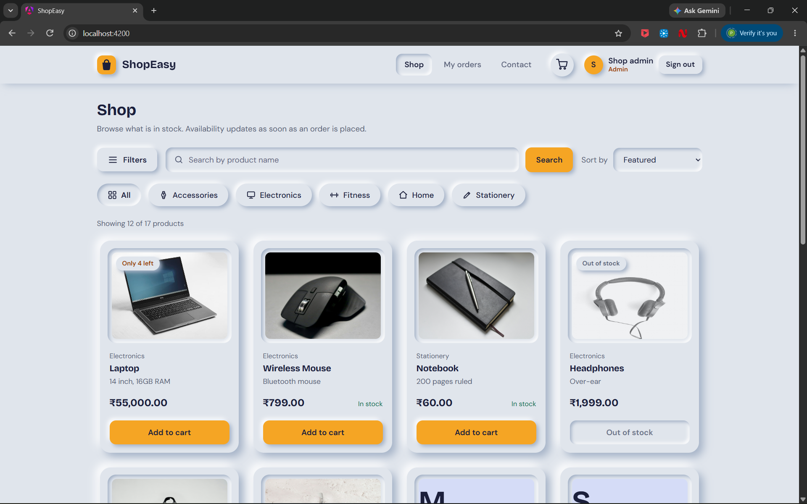<br>**Admin second step.** After the password, admins confirm a code sent to their inbox. | 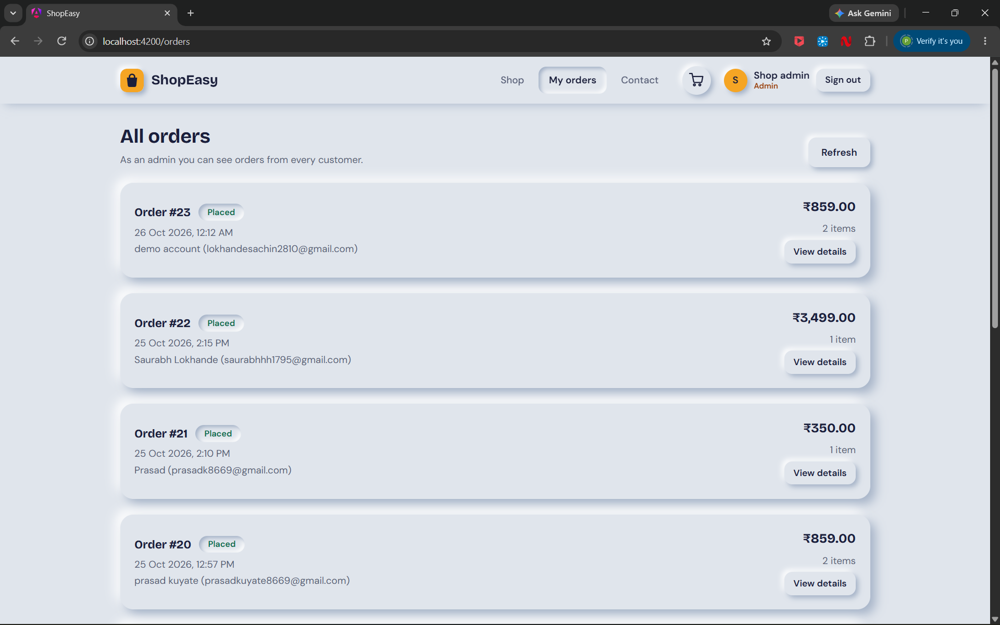<br>**Admin view.** Admins can see orders from every customer. |

Names and email addresses in these screenshots belong to demo accounts.

### Verification

**Order security checks.** Fourteen scripted checks covering missing tokens, tampered tokens, other users' orders, identity taken from the token, and input validation.

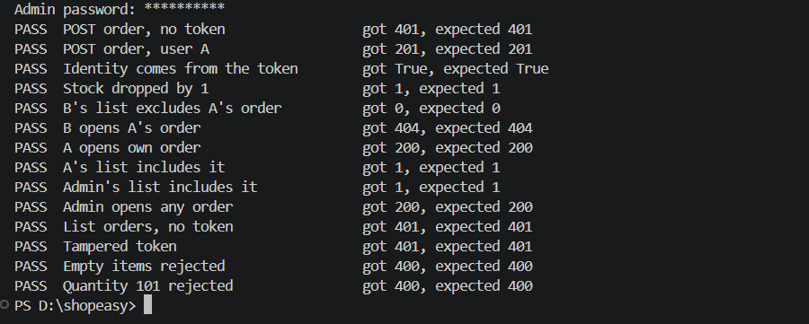

**Concurrent orders for the last item.** Ten requests at the same moment for one remaining unit: one order succeeds and the rest are refused.

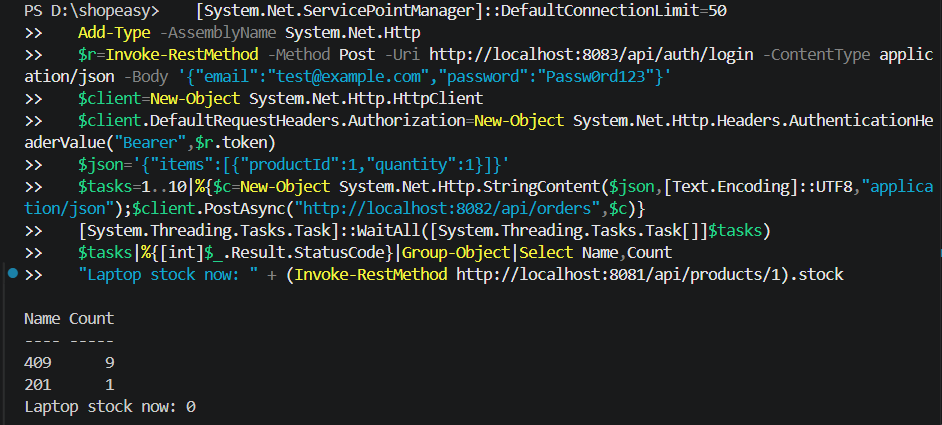

**Login lockout.** After five wrong passwords the server answers `429 Too Many Requests`.

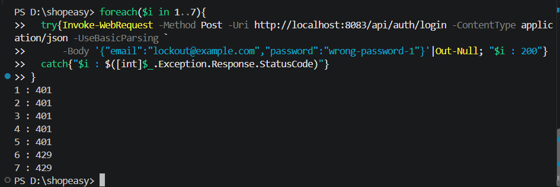

## Architecture

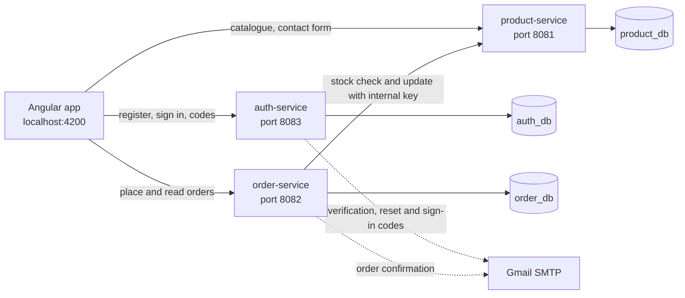

| Decision | Reason |
|---|---|
| Login lives in its own `auth-service` | One place that knows passwords. The other services only need to check a signed token. |
| Each service validates the JWT itself | No call back to auth-service per request, so it stays fast and a copy of any service can be added without shared session state. |
| Stock is protected in the database, not in Java | A `synchronized` block only protects one running copy. A conditional `UPDATE` protects every copy. |
| Entities are never returned by the API | Small response classes avoid lazy-loading errors, infinite loops and accidental exposure of fields. |
| Order items store the product name and price | Old orders keep what the customer paid even if the product changes later. |
| Confirmation emails run in the background | A slow mail server can never delay or fail an order. |
| Order Service calls Product Service with a shared internal key | Browsers never receive it, so a normal user's token cannot change stock. |

## How an order is placed

1. The browser sends only product ids and quantities. The customer's name and email come from the signed token, never from the request body.
2. Order Service merges duplicate lines and runs a friendly stock check, so the customer gets a clear message early.
3. For each product, Product Service runs `UPDATE products SET stock = stock - ? WHERE id = ? AND stock >= ?`. If no row changes, the stock was not there, and the order is refused with `409`.
4. If a later step fails, the stock already taken is given back (a small compensating action, in the spirit of the Saga pattern).
5. The order is saved with the prices copied from the products, and a confirmation email is queued.

## Security

| Area | What is implemented |
|---|---|
| Passwords | BCrypt hashes. 8 to 72 characters with a letter and a number. The same error for an unknown email and a wrong password, with equal work in both cases. |
| Sign-up | Email verification code: 6 digits, stored only as a hash, valid 10 minutes, 5 tries, 60 second resend cooldown, at most 5 sends per hour. |
| Login protection | Lockout after 5 wrong passwords for one address and email for 15 minutes. At most 20 requests per minute per address on the auth endpoints. |
| Tokens | JWT (HS256), 60 minutes. Signature, expiry and issuer are checked in every service. |
| Authorization | Deny by default. Public catalogue reads, admin-only catalogue changes, login required for orders. |
| Order ownership | Users see only their own orders. Someone else's order id returns `404`, so order numbers cannot be probed. |
| Admin sign-in | A second step with a code emailed to the admin. A short-lived challenge token with a different issuer links the two steps, so it cannot be used as a login token. |
| Account recovery | A single-use reset code tied to that purpose, a "password changed" notice, and the same response for every email address. |
| New sign-in alert | A random browser id (stored hashed) recognises known devices. An unknown device triggers an email. |
| Service-to-service | Stock endpoints accept the internal key (compared in constant time) or an admin token. |
| Database | One limited MySQL account per service. Parameterised queries only. |
| HTTP | CORS limited to the Angular origin, a strict Content-Security-Policy, `nosniff`, frame denial, no referrer, and no stack traces in error responses. |
| Secrets | Kept in git-ignored local files. Services refuse to start if a secret is missing or too weak. |
| Frontend | The token is sent only to this project's own APIs. Route guards improve the experience, while the services enforce the real rules. The cart is cleared on sign-out. |
| Dependencies | Dependabot checks Maven and npm packages weekly. |

## Tech stack

| Layer | Technology |
|---|---|
| Frontend | Angular (standalone components, signals), TypeScript, CSS |
| Backend | Java 21, Spring Boot 4, Spring Security (JWT resource server), Spring Data JPA, Spring Mail |
| ORM | Hibernate 7 / JPA |
| Database | MySQL 8, one database per service |
| Email | Gmail SMTP (or a console "log" mode for development) |
| Build | Maven wrapper, npm and Angular CLI |

## API overview

### auth-service (port 8083)

| Method | Endpoint | Purpose |
|---|---|---|
| POST | `/api/auth/register` | Create an account and email a verification code |
| POST | `/api/auth/verify-email` | Confirm the code and sign in |
| POST | `/api/auth/resend-otp` | Send a new verification code |
| POST | `/api/auth/login` | Sign in. Admins get a challenge instead of a token. |
| POST | `/api/auth/login/verify` | Admin second step |
| POST | `/api/auth/login/resend` | New admin code |
| POST | `/api/auth/forgot-password` | Email a reset code |
| POST | `/api/auth/reset-password` | Set a new password with the code |

### product-service (port 8081)

| Method | Endpoint | Who |
|---|---|---|
| GET | `/api/products` with `search`, `category`, `minPrice`, `maxPrice`, `inStock`, `sort`, `page`, `size` | Public |
| GET | `/api/products/{id}` and `/api/products/categories` | Public |
| POST, PUT, DELETE | `/api/products` and `/api/products/{id}` | Admin |
| PATCH | `/api/products/{id}/stock` and `/api/products/{id}/stock/restore` | Order Service (internal key) or admin |
| POST | `/api/contact` | Public, limited to 5 per 10 minutes per address |

`sort` accepts `featured`, `price-asc`, `price-desc` and `name`.

### order-service (port 8082)

| Method | Endpoint | Who |
|---|---|---|
| POST | `/api/orders` | Signed-in user |
| GET | `/api/orders` | Own orders. Admins get all orders. |
| GET | `/api/orders/{id}` | The owner or an admin |

## Database

| Database | Tables |
|---|---|
| `auth_db` | `users`, `email_otps` (one row per user and purpose), `known_devices` |
| `product_db` | `products`, `contact_messages` |
| `order_db` | `orders` (with `user_id`), `order_items` (one-to-many) |

Tables are created by Hibernate (`ddl-auto: update`) the first time each service starts.

## Getting started

### Prerequisites

- JDK 21 or newer
- Node.js (current LTS) and the Angular CLI: `npm install -g @angular/cli`
- MySQL 8 or newer
- A Gmail account with 2-Step Verification, for real emails. Without one, use the log mode described below.

### 1. Clone

```bash
git clone https://github.com/PrasadK8669/shopeasy.git
cd shopeasy
```

### 2. Create the databases and limited accounts

Run this in MySQL as an administrator and replace each `CHOOSE_A_PASSWORD`:

```sql
CREATE DATABASE auth_db;
CREATE DATABASE product_db;
CREATE DATABASE order_db;

CREATE USER 'shop_auth'@'localhost'    IDENTIFIED BY 'CHOOSE_A_PASSWORD';
CREATE USER 'shop_product'@'localhost' IDENTIFIED BY 'CHOOSE_A_PASSWORD';
CREATE USER 'shop_order'@'localhost'   IDENTIFIED BY 'CHOOSE_A_PASSWORD';

GRANT SELECT, INSERT, UPDATE, DELETE, CREATE, ALTER, INDEX, REFERENCES ON auth_db.*    TO 'shop_auth'@'localhost';
GRANT SELECT, INSERT, UPDATE, DELETE, CREATE, ALTER, INDEX, REFERENCES ON product_db.* TO 'shop_product'@'localhost';
GRANT SELECT, INSERT, UPDATE, DELETE, CREATE, ALTER, INDEX, REFERENCES ON order_db.*   TO 'shop_order'@'localhost';
```

Each account can only reach its own database. `CREATE` and `ALTER` are there because Hibernate builds the tables. A production setup would use migrations and remove them.

### 3. Generate two secrets

You need two different random values: one for signing tokens and one for the internal key between Order Service and Product Service.

```powershell
# Windows PowerShell
$b = New-Object byte[] 32
[Security.Cryptography.RandomNumberGenerator]::Create().GetBytes($b)
[Convert]::ToBase64String($b)
```

```bash
# macOS or Linux
openssl rand -base64 32
```

Run it twice. The token secret is shared by all three services, and the internal key is shared by product-service and order-service.

### 4. Create the local config files

Each service reads secrets from `src/main/resources/application-local.yml`. These files are listed in `.gitignore`. **Never commit them.** Keep `spring:` and `app:` at the left edge, and use spaces, not tabs.

**`auth-service/src/main/resources/application-local.yml`**

```yaml
spring:
  datasource:
    username: "shop_auth"
    password: "MYSQL_PASSWORD_FOR_shop_auth"
  mail:
    username: "your-sender@gmail.com"
    password: "YOUR_16_CHARACTER_GMAIL_APP_PASSWORD"
app:
  jwt:
    secret: "TOKEN_SECRET"
  admin:
    email: "yourname+admin@gmail.com"
    password: "A_STRONG_ADMIN_PASSWORD"
  mail:
    from: "your-sender@gmail.com"
    # mode: log      # development only: prints emails to the console instead of sending
```

**`product-service/src/main/resources/application-local.yml`**

```yaml
spring:
  datasource:
    username: "shop_product"
    password: "MYSQL_PASSWORD_FOR_shop_product"
app:
  jwt:
    secret: "TOKEN_SECRET"
  internal:
    api-key: "INTERNAL_KEY"
```

**`order-service/src/main/resources/application-local.yml`**

```yaml
spring:
  datasource:
    username: "shop_order"
    password: "MYSQL_PASSWORD_FOR_shop_order"
  mail:
    username: "your-sender@gmail.com"
    password: "YOUR_16_CHARACTER_GMAIL_APP_PASSWORD"
app:
  jwt:
    secret: "TOKEN_SECRET"
  internal:
    api-key: "INTERNAL_KEY"
  mail:
    from: "your-sender@gmail.com"
    # mode: log
```

Notes:

- **The admin email must be a mailbox you can open**, because admin sign-in sends a code there. With Gmail, `yourname+admin@gmail.com` arrives in `yourname@gmail.com`.
- **Gmail app password:** turn on 2-Step Verification, then create an app password at `myaccount.google.com/apppasswords`. Enter it without spaces. Use the same address for `username` and `from`. A separate Gmail account for the project is a good idea.
- **No Gmail yet?** Uncomment `mode: log` in the auth-service and order-service files. Codes and emails are then printed in each service's console. Use this for development only, because it exposes the codes.
- **Emergency switch:** `app.mfa.admin-enabled: false` in the auth-service file turns off the admin second step. Remove it again afterwards.

### 5. Start the services

Use a separate terminal for each. On Windows use `.\mvnw`, and on macOS or Linux use `./mvnw`.

```bash
cd auth-service    && ./mvnw spring-boot:run
cd product-service && ./mvnw spring-boot:run
cd order-service   && ./mvnw spring-boot:run
```

Then the frontend:

```bash
cd frontend
npm install
ng serve
```

Open **http://localhost:4200**. The first start of `auth-service` creates the admin account from the `app.admin.*` settings.

### 6. Add products

Run this once in MySQL after `product-service` has started. It creates the 17 demo products used in the screenshots. Photos are served from `frontend/public/products/`, and a product without a photo falls back to a coloured letter tile.

<details>
<summary>Seed data</summary>

```sql
USE product_db;

INSERT INTO products (name, description, price, stock, category, image_url) VALUES
('Laptop', '14 inch, 16GB RAM', 55000.00, 10, 'Electronics', '/products/laptop.jpg'),
('Wireless Mouse', 'Bluetooth mouse', 799.00, 25, 'Electronics', '/products/wireless-mouse.jpg'),
('Notebook', '200 pages ruled', 60.00, 100, 'Stationery', '/products/notebook.jpg'),
('Headphones', 'Over-ear', 1999.00, 5, 'Electronics', '/products/headphones.jpg'),
('Water Bottle', '1 litre steel', 350.00, 40, 'Home', '/products/water-bottle.jpg'),
('Backpack', '30 litre', 1499.00, 15, 'Accessories', '/products/backpack.jpg'),
('Mechanical Keyboard', 'Compact 75% layout, blue switches', 3499.00, 18, 'Electronics', '/products/mechanical-keyboard.jpg'),
('Smart Watch', 'Heart-rate and sleep tracking', 4999.00, 12, 'Electronics', '/products/smart-watch.jpg'),
('Power Bank', '20000 mAh, fast charging', 1799.00, 30, 'Electronics', '/products/power-bank.jpg'),
('Gel Pen Set', 'Pack of 10, assorted colours', 199.00, 80, 'Stationery', '/products/gel-pen-set.jpg'),
('Desk Planner', 'Weekly planner, 52 pages', 299.00, 45, 'Stationery', '/products/desk-planner.jpg'),
('Desk Lamp', 'LED, adjustable brightness', 1299.00, 22, 'Home', '/products/desk-lamp.jpg'),
('Coffee Mug', '350 ml ceramic', 249.00, 60, 'Home', '/products/coffee-mug.jpg'),
('Sunglasses', 'UV400 polarised', 899.00, 25, 'Accessories', '/products/sunglasses.jpg'),
('Leather Wallet', 'Slim, six card slots', 999.00, 20, 'Accessories', '/products/leather-wallet.jpg'),
('Yoga Mat', '6 mm non-slip', 799.00, 35, 'Fitness', '/products/yoga-mat.jpg'),
('Resistance Bands', 'Set of 5 levels', 599.00, 40, 'Fitness', '/products/resistance-bands.jpg');
```

</details>

### 7. Try it

1. Create an account. A 6-digit code arrives by email (or in the console in log mode). Enter it and you are signed in.
2. Add products to the cart and place an order. A confirmation email follows.
3. Sign in as the admin. After the password, enter the code sent to the admin mailbox. The orders page now shows every customer's orders.

### Troubleshooting

| Symptom | Likely cause |
|---|---|
| A service stops at startup with `app.jwt.secret ...` | The secret is missing or malformed in that service's local file. It must be base64 and decode to at least 32 bytes. |
| `Access denied for user` at startup | The MySQL password in the local file does not match the account, or `username` is missing |
| Every sign-in answers `401` on other services | The token secret differs between the services |
| Orders fail with `401` in the Order Service console | The internal key differs between product-service and order-service |
| No emails arrive | A wrong Gmail app password (no spaces), `from` differs from `username`, or the message is in the spam folder |
| A service ignores your local file | `spring:` or `app:` is indented, there are two `app:` blocks, or the service was not restarted |

## How it was tested

The services were tested through scripted requests (PowerShell), with the results shown in the screenshots above.

| Check | Result |
|---|---|
| No token, tampered token, expired session | `401` |
| Normal user calling admin endpoints | `403` |
| User opening another user's order | `404` |
| Order identity | Name and email come from the token, even if the body sends fake ones |
| Input validation | Empty order and quantity of 101 are refused with `400` |
| Ten simultaneous orders for the last unit | One `201`, the rest `409`, and the stock ends at 0 |
| Five wrong passwords | Sixth attempt answers `429` |
| Admin challenge token used on another service | `401` |
| Verification codes | Wrong codes, expiry and resend limits behave as described in [Security](#security) |

## Project structure

```text
shopeasy/
├── auth-service/       accounts, JWT, email codes, device tracking
├── product-service/    catalogue, filters, stock, contact messages
├── order-service/      orders, ownership checks, order emails
├── frontend/           Angular app (photos in public/products)
├── docs/screenshots/   images used in this README
├── .github/            Dependabot configuration
└── README.md
```

## Known limits and roadmap

This is a learning project for local use, not a production deployment.

**Known limits**

- No HTTPS in local development. Tokens and passwords need TLS in production.
- Tokens cannot be revoked before they expire (60 minutes). A password reset does not end an existing session.
- Tokens are signed with one shared secret (HS256). Production would use an asymmetric key or an identity provider.
- Rate limits and login lockouts live in memory, so they reset on restart and are counted per running copy.
- Email codes are a modest second factor. An authenticator app or a hardware key would be stronger.
- The internal key between services is a static shared secret. Mutual TLS or short-lived service tokens would be better.
- Tables are created by Hibernate. A real deployment would use migrations such as Flyway.
- The cart lives in the browser's memory and is lost on reload.
- There is no payment step, and the admin can manage products through the API only (there is no admin screen yet).
- The services were tested with scripted requests. Automated unit and integration tests are still to be written.

**Ideas for next steps**

- Admin screen for products and a view of contact messages
- JUnit and Testcontainers tests for the stock logic
- Docker Compose with several copies of each service behind a reverse proxy, plus a load test
- Refresh tokens and an authenticator-app second factor
- Flyway migrations, Redis-backed rate limits, and a background queue for email

## Credits

- Product photos from [Unsplash](https://unsplash.com) and [Pexels](https://www.pexels.com).
- Built as a learning project with AI assistance. I reviewed, ran and tested every service.

## Author

**Prasad Vilas Kuyate**

- GitHub: [PrasadK8669](https://github.com/PrasadK8669)
- LinkedIn: [prasad-kuyate](https://www.linkedin.com/in/prasad-kuyate-965467322/)
