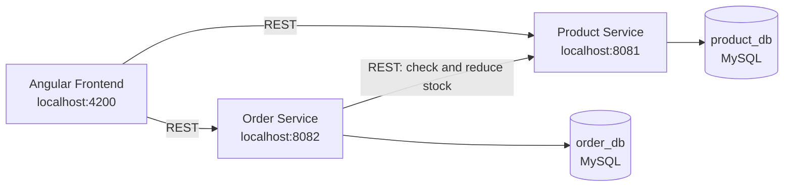

# ShopEasy: Order Management System

A full-stack e-commerce order management application built with **Angular**, **Spring Boot microservices**, **Hibernate/JPA** and **MySQL**. Customers can browse products, add them to a cart and place orders. The Order Service checks and updates stock by calling the Product Service over REST.

## Table of Contents

- [Features](#features)
- [Tech Stack](#tech-stack)
- [Architecture](#architecture)
- [Database Design](#database-design)
- [Project Structure](#project-structure)
- [Getting Started](#getting-started)
- [API Endpoints](#api-endpoints)
- [Testing](#testing)
- [Screenshots](#screenshots)
- [Future Improvements](#future-improvements)
- [Development Note](#development-note)
- [Author](#author)

## Features

**Product Service**
- Create, read, update and delete products (name, price, stock, category)
- Pagination and search by name
- Input validation and consistent error responses via a global exception handler

**Order Service**
- Place an order containing multiple products
- Verifies stock with the Product Service and reduces it when the order is placed
- Rejects the order with a clear error message if stock is insufficient
- Returns a meaningful error if the Product Service is unavailable
- View order history and order details

**Angular Frontend**
- Product listing with search and pagination
- Shopping cart
- Checkout form with validation (reactive forms)
- Order history page
- Routing, services with `HttpClient`, and error handling

## Tech Stack

| Layer | Technology |
|---|---|
| Frontend | Angular, TypeScript, HTML5, CSS3 |
| Backend | Java, Spring Boot (Spring Web, Spring Data JPA, Validation) |
| ORM | Hibernate / JPA |
| Database | MySQL (separate database per service) |
| Service communication | REST (OpenFeign / RestTemplate) |
| API documentation | Swagger / OpenAPI (springdoc) |
| Testing | JUnit, Mockito, Postman |
| Build tools | Maven, npm / Angular CLI |
| Version control | Git, GitHub |

## Architecture



**Key design decisions**
- **Two services, two databases.** Product data and order data are owned by separate services, so each can change independently.
- **Order Service stores only product IDs and a price snapshot** in `order_items`, not a foreign key to the product table, because the products live in another database.
- **Stock is validated at order time** by calling the Product Service, so the product catalogue stays the single source of truth for inventory.

## Database Design

**product_db**

| Table | Main columns |
|---|---|
| `products` | id, name, description, price, stock, category |

**order_db**

| Table | Main columns |
|---|---|
| `orders` | id, customer_name, customer_email, total_amount, status, created_at |
| `order_items` | id, order_id (FK), product_id, product_name, unit_price, quantity |

Relationship: one `Order` has many `OrderItem` (`@OneToMany` / `@ManyToOne`).

## Project Structure

```
shopeasy/
├── product-service/        # Spring Boot: product catalogue and stock
│   └── src/main/java/...   # controller, service, repository, entity, exception
├── order-service/          # Spring Boot: orders and order items
│   └── src/main/java/...   # controller, service, repository, entity, client, exception
├── frontend/               # Angular application
│   └── src/app/            # components, services, models, routing
└── README.md
```

## Getting Started

### Prerequisites

- Java 25 or later
- Maven 3.8+
- Node.js 18+ and npm
- Angular CLI (`npm install -g @angular/cli`)
- MySQL 8+

### 1. Create the databases

```sql
CREATE DATABASE product_db;
CREATE DATABASE order_db;
```

### 2. Configure the services

Edit `src/main/resources/application.properties` in each service and set your MySQL username and password.

**product-service**
```properties
server.port=8081
spring.datasource.url=jdbc:mysql://localhost:3306/product_db
spring.datasource.username=YOUR_USERNAME
spring.datasource.password=YOUR_PASSWORD
spring.jpa.hibernate.ddl-auto=update
```

**order-service**
```properties
server.port=8082
spring.datasource.url=jdbc:mysql://localhost:3306/order_db
spring.datasource.username=YOUR_USERNAME
spring.datasource.password=YOUR_PASSWORD
spring.jpa.hibernate.ddl-auto=update
product.service.url=http://localhost:8081
```

### 3. Run the backend

Start the Product Service first, then the Order Service, each in its own terminal.

```bash
cd product-service
mvn spring-boot:run
```

```bash
cd order-service
mvn spring-boot:run
```

### 4. Run the frontend

```bash
cd frontend
npm install
ng serve
```

Open **http://localhost:4200** in your browser.

### API documentation (Swagger)

- Product Service: http://localhost:8081/swagger-ui/index.html
- Order Service: http://localhost:8082/swagger-ui/index.html

## API Endpoints

### Product Service (`:8081`)

| Method | Endpoint | Description |
|---|---|---|
| GET | `/api/products?page=0&size=10&search=` | List products (paginated, searchable) |
| GET | `/api/products/{id}` | Get a product by ID |
| POST | `/api/products` | Create a product |
| PUT | `/api/products/{id}` | Update a product |
| DELETE | `/api/products/{id}` | Delete a product |
| PATCH | `/api/products/{id}/stock` | Reduce stock (called by Order Service) |

### Order Service (`:8082`)

| Method | Endpoint | Description |
|---|---|---|
| POST | `/api/orders` | Place an order |
| GET | `/api/orders` | List all orders |
| GET | `/api/orders/{id}` | Get order details |

**Sample request: place an order**

```json
POST /api/orders
{
  "customerName": "Prasad Kuyate",
  "customerEmail": "prasad@example.com",
  "items": [
    { "productId": 1, "quantity": 2 },
    { "productId": 3, "quantity": 1 }
  ]
}
```

**Sample error response: insufficient stock**

```json
{
  "status": 409,
  "error": "Conflict",
  "message": "Insufficient stock for product ID 1"
}
```

## Testing

Run the unit tests for each service:

```bash
cd product-service && mvn test
cd order-service && mvn test
```

The service layer is tested with **JUnit** and **Mockito**. All endpoints were also tested manually with **Postman**.

## Screenshots

<!-- Add screenshots to docs/screenshots/ and uncomment the lines below. -->
<!--


-->

## Future Improvements

- API Gateway (Spring Cloud Gateway) as a single entry point
- Service discovery with Eureka
- JWT authentication and role-based access (admin and customer)
- Resilience4j circuit breaker and retry for the Order-to-Product call
- Dockerize both services and the databases with Docker Compose
- Transactional consistency across services using the Saga pattern

## Development Note

This project was built with the help of AI tools. I reviewed the generated code, ran and tested every service, and can explain the design, including the Order-to-Product service call, the Hibernate entity relationships and the Angular data flow.

## Author

**Prasad Vilas Kuyate**
- GitHub: [PrasadK8669](https://github.com/PrasadK8669)
- LinkedIn: [prasad-kuyate](https://www.linkedin.com/in/prasad-kuyate-965467322/)
